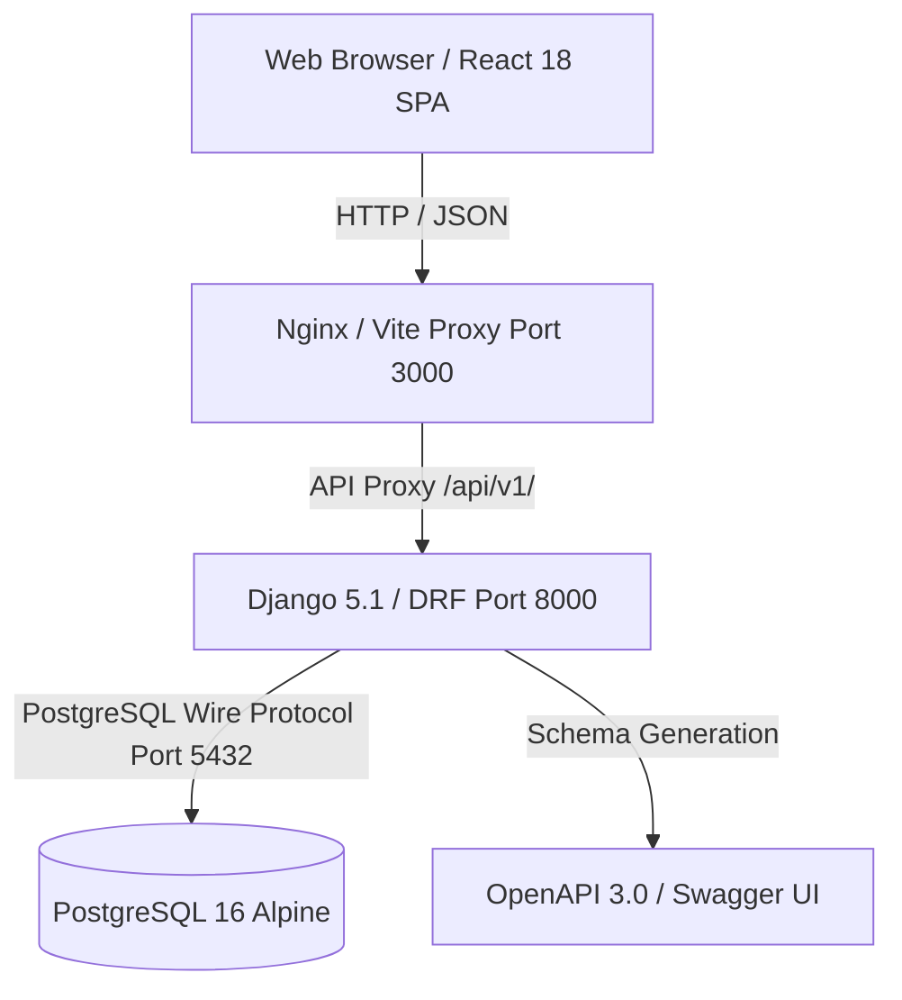

# LogiFlows Software Requirements Specification (SRS)

## 1. Introduction
This Software Requirements Specification defines the operational, technical, and structural criteria for **LogiFlows**, an AI-Powered Smart Postal and B2B Logistics Management Web Platform.

### 1.1 Purpose
The purpose of this document is to establish authoritative requirements across all 12 planned development phases, starting with the Phase 00 architecture foundation.

### 1.2 System Scope
LogiFlows is a multi-tenant web application supporting:
- Multi-organization freight management (3PL providers, line-haul carriers, shippers, freight forwarders).
- Fleet registration, vehicle maintenance, and driver dispatching.
- Consignment booking, dimensional weight rating, and waybill printing.
- Cryptographic QR-code custody verification across transit hubs.
- AI-driven delay prediction and dynamic route planning.
- Automated billing, SLA detention rating, and executive business analytics.

---

## 2. Overall Description

### 2.1 System Architecture Topology

### 2.2 System Actors
| Role | Code | Primary Responsibilities |
| :--- | :--- | :--- |
| **Super Administrator** | `SUPER_ADMIN` | Global platform configuration, tenant onboarding, billing plans, audit telemetry. |
| **Tenant Administrator** | `TENANT_ADMIN` | Organization branch setup, staff account management, internal RBAC, client profiles. |
| **Logistics Manager** | `LOGISTICS_MANAGER` | Line-haul routing, fleet allocation, carrier service contracts, hub operations. |
| **Dispatcher** | `DISPATCHER` | Run-sheet compilation, driver dispatch, milestone verification, exception handling. |
| **Driver / Field Agent** | `DRIVER` | Pick-up execution, QR custody handoffs, proof-of-delivery (POD) signature capture. |
| **Auditor / Shipper Client** | `AUDITOR_VIEWER` | Shipment tracking, waybill custody history review, freight invoices and reports. |

---

## 3. Specific Requirements Overview
Requirements are detailed in:
- [`functional-requirements.md`](file:///c:/Users/PUTTU/Desktop/Logiflows%20B@B%20service%20platform/docs/02-requirements/functional-requirements.md)
- [`non-functional-requirements.md`](file:///c:/Users/PUTTU/Desktop/Logiflows%20B@B%20service%20platform/docs/02-requirements/non-functional-requirements.md)
