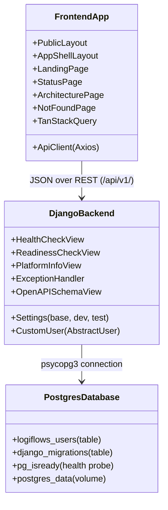

# LogiFlows Component Diagram

## Component Boundaries & Inter-Service Networking
1. **Frontend to Backend**:
   - Local Browser access: `http://localhost:3000`
   - Internal Docker Reverse Proxy: Requests matching `/api/v1/*` are proxied to `http://backend:8000/api/v1/*`
2. **Backend to Database**:
   - Internal DNS name: `db`
   - Internal port: `5432`
   - Managed connection pool with max lifetime of 60 seconds (`CONN_MAX_AGE = 60`)
