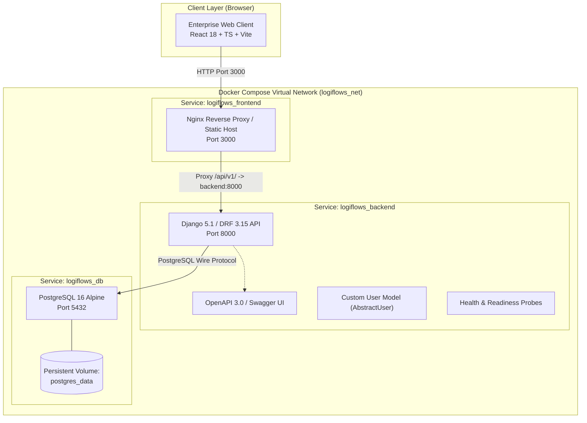

# LogiFlows System Architecture

## 1. Architectural Philosophy
LogiFlows is built following a decoupled, layered service architecture. It separates presentation (React SPA), API application logic (Django REST Framework), and persistence (PostgreSQL 16) into independent containerized components communicating over internal virtual bridge networks.

---

## 2. Multi-Tier Container Architecture

---

## 3. Layer Breakdown

### 3.1 Presentation Layer (Frontend)
- **Framework**: React 18, TypeScript, Vite.
- **Styling**: Tailwind CSS with enterprise color tokens (Navy, Blue, White, Restrained Teal) and glassmorphism paneling.
- **Routing**: React Router declarative client-side routes (`/`, `/app/status`, `/app/architecture`, `*`).
- **Server State**: TanStack Query managing caching, deduplication, and periodic polling (10s intervals).
- **HTTP Client**: Centralized Axios instance with base URL resolution and error interceptors.

### 3.2 Application & Business Layer (Backend)
- **Framework**: Python 3.12, Django 5.1, Django REST Framework 3.15.
- **Settings Hierarchy**:
  - `config.settings.base`: Common settings, DRF configuration, Spectactular OpenAPI settings, centralized logging.
  - `config.settings.development`: Debug enabled, verbose console logging.
  - `config.settings.test`: Fast in-memory database fallback, password hasher acceleration.
- **Identity Foundation**: Minimal custom User model (`apps.users.models.User`) extending `AbstractUser`.
- **API Standards**: Uniform error envelopes, pagination defaults (20 items/page), CORS restriction to authorized origins.

### 3.3 Persistence Layer (Database)
- **Engine**: PostgreSQL 16 Alpine.
- **Volume**: `postgres_data` named Docker volume mounted at `/var/lib/postgresql/data`.
- **Readiness Verification**: `pg_isready -U logiflows_user -d logiflows_db` health probe run every 5 seconds.
