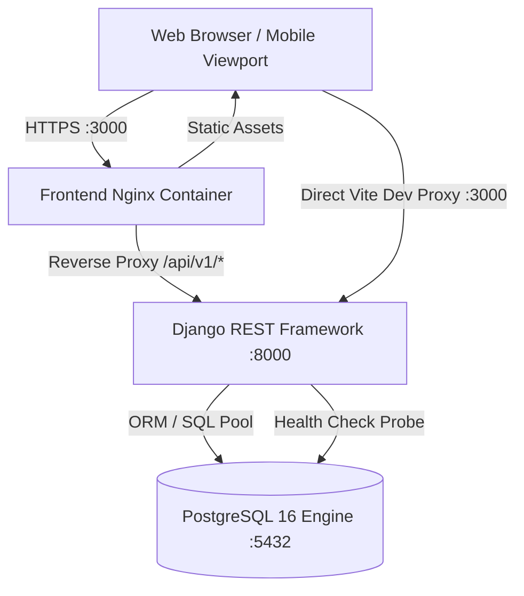

# System Architecture & Technical Specifications — LogiFlows

## 1. High-Level Architecture
LogiFlows adopts a decoupled Service-Oriented Architecture (SOA) consisting of a stateless Django REST Framework API backend, a PostgreSQL 16 relational datastore, and a modern React 18 / TypeScript / Vite Single Page Application.

## 2. Containerized Micro-Topology
The platform is orchestrated via `docker-compose.yml` comprising three core services:

1. **`db` (PostgreSQL 16 Alpine)**:
   - Persistent volume: `postgres_data:/var/lib/postgresql/data`
   - Healthcheck: `pg_isready -U logiflows_user -d logiflows_db`
   - Port binding: `5432:5432`

2. **`backend` (Python 3.12 / Django 5.0 / DRF 3.15)**:
   - Stateless WSGI/ASGI service
   - Dependencies: `psycopg` 3.1, `djangorestframework`, `django-cors-headers`
   - Dependency order: Waits for `db` to pass health check before boot
   - Healthcheck: `curl -f http://localhost:8000/api/v1/health/`
   - Port binding: `8000:8000`

3. **`frontend` (Node 20 / React 18 / Vite / Nginx)**:
   - High-performance, production-ready static build served by Alpine Nginx
   - Reverse proxies all `/api/` requests to the backend container
   - Port binding: `3000:3000`

## 3. Multi-Tenant Isolation Strategy
LogiFlows implements **shared-database with row-level tenant scoping**:
- All tenant-owned tables (`orders`, `shipments`, `invoices`, `drivers`, `vehicles`) feature a mandatory `tenant_id` foreign key referencing the `organizations` table.
- DRF ViewSets automatically inject the authenticated user's `organization_id` into query filters (`queryset.filter(organization=request.user.organization)`).
- Cross-tenant data leaks are physically blocked at the database query layer.

## 4. Security Architecture
- **Stateless Authorization**: JWT / Token-based authentication with cryptographically signed payloads.
- **Backend Validation**: Authorization decisions are strictly evaluated in Django permissions classes (`IsAuthenticated`, `IsTenantAdmin`, `CanDispatchShipment`).
- **Secret Management**: Sensitive keys (`DJANGO_SECRET_KEY`, database credentials) are injected through `.env` files and environment variables, never committed to git.
