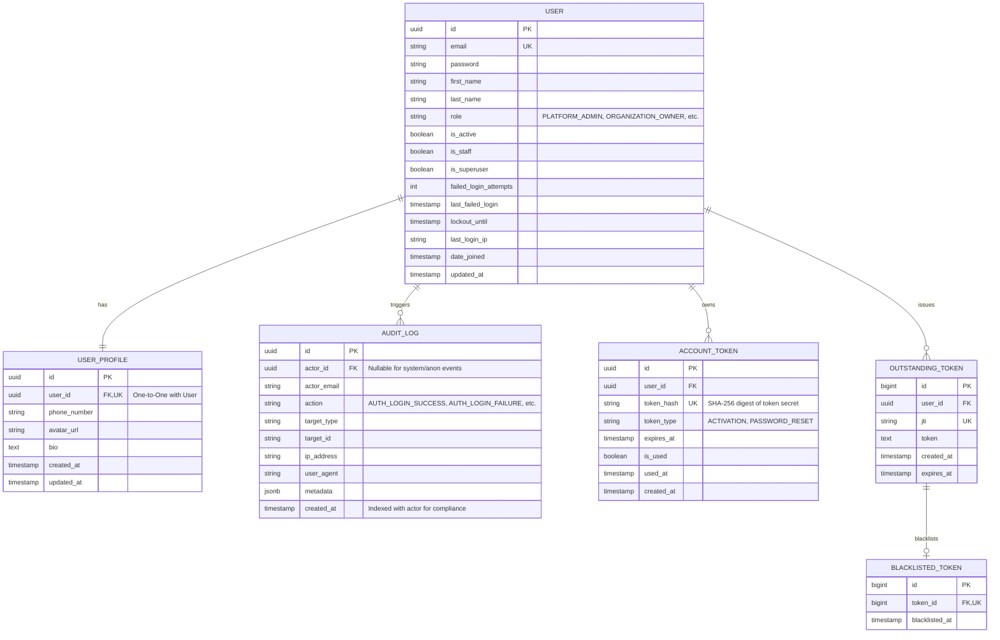

# Entity-Relationship (ER) Diagram & Schema Baseline

## 1. Domain Entities & Architecture
The LogiFlows relational schema in PostgreSQL 16 is structured for security, multi-tenancy, and high-integrity audit logging.

### Phase 1 Implemented Schema

## 2. Table Specifications & Indexes

### 2.1 `accounts_user`
- `id`: UUIDv4, Primary Key.
- `email`: Normalized lowercase string (max 255), Unique index.
- `role`: CharField (max 30), choices: `PLATFORM_ADMIN`, `ORGANIZATION_OWNER`, `ORGANIZATION_ADMIN`, `BRANCH_MANAGER`, `EMPLOYEE`, `CUSTOMER`. Default: `CUSTOMER`.
- `failed_login_attempts`: PositiveSmallIntegerField, default `0`.
- `lockout_until`: DateTimeField, null allowed, indexed for lockout lookups.
- `last_login_ip`: GenericIPAddressField, null allowed.

### 2.2 `accounts_userprofile`
- `id`: UUIDv4, Primary Key.
- `user_id`: One-to-one foreign key to `accounts_user(id)`, on delete `CASCADE`.
- `phone_number`: CharField (max 30), blank.
- `avatar_url`: URLField (max 500), blank.
- `bio`: TextField, blank.

### 2.3 `accounts_auditlog`
- `id`: UUIDv4, Primary Key.
- `actor_id`: ForeignKey to `accounts_user(id)`, on delete `SET_NULL`, nullable.
- `actor_email`: CharField (max 255), stores historical email in case actor is deleted.
- `action`: CharField (max 100), indexed.
- `target_type`: CharField (max 100), blank.
- `target_id`: CharField (max 255), blank.
- `ip_address`: GenericIPAddressField, nullable.
- `user_agent`: TextField, blank.
- `metadata`: JSONField (PostgreSQL JSONB), default `dict`.
- Compound Index: `[actor, created_at]`.
- Single Index: `[action]`.

### 2.4 `accounts_accounttoken`
- `id`: UUIDv4, Primary Key.
- `user_id`: ForeignKey to `accounts_user(id)`, on delete `CASCADE`.
- `token_hash`: CharField (max 64), stores SHA-256 hash of single-use token, unique index.
- `token_type`: CharField (max 30), choices `ACTIVATION`, `PASSWORD_RESET`.
- `expires_at`: DateTimeField.
- `is_used`: BooleanField, default `False`.
- `used_at`: DateTimeField, nullable.

### 2.5 SimpleJWT Token Blacklist
- Integrated with `rest_framework_simplejwt.token_blacklist` to support rotating refresh tokens and revocation on logout or password changes.
