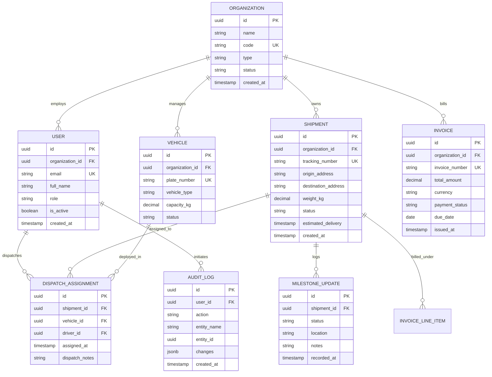

# Entity-Relationship (ER) Diagram & Schema Baseline

## 1. Domain Entities
The LogiFlows relational schema in PostgreSQL 16 is centered around multi-tenancy, shipment tracking, and financial ledgers.

## 2. Table Specifications
- **`organizations`**: Master tenant table for Shippers, Carriers, and 3PL Providers.
- **`users`**: Tenant-scoped accounts with granular role bindings.
- **`shipments`**: Freight records enforcing state transitions (`DRAFT` through `DELIVERED`).
- **`milestone_updates`**: Immutable chronological breadcrumbs for shipment location and events.
- **`vehicles`**: Physical assets (tractors, trailers, box trucks) with inspection and capacity metadata.
- **`invoices`**: Financial bills calculated from contract rates and shipment milestones.
- **`audit_logs`**: Tamper-evident ledger of user and system mutations.
