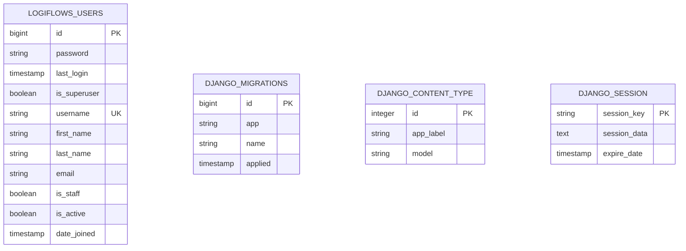
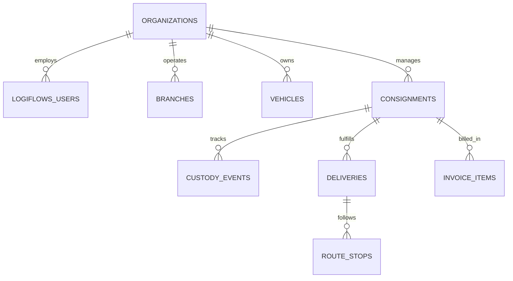

# LogiFlows Initial Entity-Relationship (ER) Diagram

## 1. Phase 00 Implemented Schema

---

## 2. Planned Future Schema (Phase 01–Phase 11 Roadmap Reference)

*Note: Future business entities are planned for subsequent phases and are strictly not created during Phase 00.*
