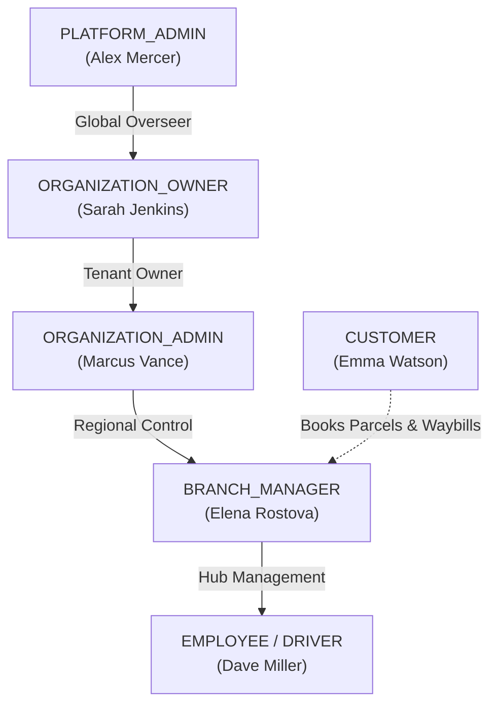

# LogiFlows — Sample Users & Role Specifications Matrix

**Document Reference:** `docs/05-role-matrix/sample-users-and-role-specifications.md`  
**Applicable Phases:** Phase 01 (Authentication & RBAC) through Phase 11 (Analytics & Intelligence)  
**Last Updated:** 2026-10-31  
**Status:** Approved & Implemented  

---

## 1. Overview & Purpose

LogiFlows enforces a multi-tenant, zero-trust **Role-Based Access Control (RBAC)** architecture. Authorization is evaluated strictly on the **backend** using Django REST Framework (DRF) permission classes, object-level ownership checks, and multi-tenant queryset boundaries.

This document serves as the authoritative engineering guide and testing reference containing concrete **sample personas for all six (6) canonical system roles**:
1. **`PLATFORM_ADMIN`** — Global Platform Super Administrator
2. **`ORGANIZATION_OWNER`** — Enterprise Logistics Tenant Owner / C-Suite
3. **`ORGANIZATION_ADMIN`** — Regional Operations Administrator / Logistics Director
4. **`BRANCH_MANAGER`** — Sorting Hub & Branch Facility Manager
5. **`EMPLOYEE`** — Logistics Dispatcher, Sorting Clerk & Driver/Courier
6. **`CUSTOMER`** — Public Consignor, Consignee & B2B Client (Default Self-Registration Role)

---

## 2. Quick Reference Credential Cheat-Sheet (Development / Testing)

> [!WARNING]
> The passwords listed below (`LogiFlowsDev2026!`) are strictly reserved for local development, staging environments, and automated E2E tests. Production deployments require cryptographically generated passwords enforced by Django's `MinimumLengthValidator`, `CommonPasswordValidator`, and `NumericPasswordValidator`.

| Role | Sample User Name | Sample Email | Dev Password | Target Scope | Initial Status |
| :--- | :--- | :--- | :--- | :--- | :---: |
| **`PLATFORM_ADMIN`** | Alex Mercer | `alex.mercer@logiflows.admin` | `LogiFlowsDev2026!` | Global Platform | `Active / Staff / Superuser` |
| **`ORGANIZATION_OWNER`** | Sarah Jenkins | `sarah.jenkins@swiftpost.com` | `LogiFlowsDev2026!` | SwiftPost Logistics (Tenant) | `Active / Non-Staff` |
| **`ORGANIZATION_ADMIN`** | Marcus Vance | `marcus.vance@swiftpost.com` | `LogiFlowsDev2026!` | SwiftPost Logistics (Tenant) | `Active / Non-Staff` |
| **`BRANCH_MANAGER`** | Elena Rostova | `elena.rostova@swiftpost.com` | `LogiFlowsDev2026!` | Metro Hub #04 (Branch) | `Active / Non-Staff` |
| **`EMPLOYEE`** | Dave Miller | `dave.miller@swiftpost.com` | `LogiFlowsDev2026!` | Metro Hub #04 (Operations/Fleet) | `Active / Non-Staff` |
| **`CUSTOMER`** | Emma Watson | `emma.watson@apexsupplies.com`| `LogiFlowsDev2026!` | Self-Service Consignor | `Active (via Email Verification)` |

---

## 3. Comprehensive Role Specifications & Personas



---

### 3.1 Role 1: `PLATFORM_ADMIN` (Platform Administrator)

#### A. Persona & Responsibilities
- **Persona Name:** Alex Mercer
- **Job Title:** Chief Systems Architect & Platform Infrastructure Lead
- **Domain Responsibilities:**
  - System-wide infrastructure observability, PostgreSQL cluster health, and Redis/Celery queue telemetry.
  - Creation and onboarding of new enterprise tenant organizations (`POST /api/v1/organizations/`).
  - Read-only forensic auditing of platform security logs across all tenants (`AuditLog`).
  - System bootstrap maintenance commands (database migrations, global parameters).
  - Enforcing platform rate throttles and investigating tenant abuse.

#### B. Complete Database Record
```json
{
  "id": "11111111-1111-4111-8111-111111111111",
  "email": "alex.mercer@logiflows.admin",
  "first_name": "Alex",
  "last_name": "Mercer",
  "role": "PLATFORM_ADMIN",
  "is_active": true,
  "is_staff": true,
  "is_superuser": true,
  "failed_login_attempts": 0,
  "lockout_until": null,
  "last_login_ip": "127.0.0.1",
  "profile": {
    "id": "11111111-1111-4111-8111-222222222222",
    "phone": "+1-555-010-0001",
    "avatar_url": "https://images.unsplash.com/photo-1534528741775-53994a69daeb?auto=format&fit=crop&w=256&h=256&q=80",
    "bio": "Lead System Architect & Global Infrastructure Administrator at LogiFlows Core."
  },
  "created_at": "2026-10-30T00:00:00Z"
}
```

#### C. Backend Permissions & Boundaries
- **DRF Permission Classes:** `IsPlatformAdmin`, `IsAuthenticated`.
- **Permitted API Endpoints:**
  - `POST /api/v1/auth/login/`, `POST /api/v1/auth/refresh/`, `POST /api/v1/auth/logout/`
  - `POST /api/v1/auth/password/change/`, `GET/PATCH /api/v1/users/me/`, `GET /api/v1/users/me/profile/`
  - `GET /api/v1/health/`, `GET /api/v1/readiness/`, `GET /api/v1/schema/`, `GET /api/v1/docs/`
  - Global tenant endpoints (Phase 2): `GET/POST /api/v1/organizations/`, `GET /api/v1/admin/audit-logs/`
- **Permitted Frontend UI Routes:**
  - `/app/status` (Platform Telemetry & Database Latency)
  - `/app/architecture` (12-Phase Roadmap Console)
  - `/profile` (Personal & Security Profile Settings)
  - `/admin` (Django Administration Interface)
- **Strict Boundaries & Forbidden Operations:**
  - Cannot be created via any public or authenticated API endpoint (only via `python manage.py createplatformadmin`).
  - Cannot bypass immutable audit log creation (`AuditLog.objects.create()` triggered on every sensitive mutation).

#### D. How to Provision
```bash
python manage.py createplatformadmin \
  --email "alex.mercer@logiflows.admin" \
  --password "LogiFlowsDev2026!" \
  --first-name "Alex" \
  --last-name "Mercer"
```

---

### 3.2 Role 2: `ORGANIZATION_OWNER` (Organization Owner)

#### A. Persona & Responsibilities
- **Persona Name:** Sarah Jenkins
- **Job Title:** Chief Executive Officer (CEO) — SwiftPost Logistics B2B
- **Domain Responsibilities:**
  - Executive tenant ownership of SwiftPost Logistics (`organization_id = "22222222-2222-4222-8222-000000000001"`).
  - Contract signing, billing subscription management, and payment gateway settlement configurations.
  - Adding, assigning, and revoking `ORGANIZATION_ADMIN` accounts.
  - Reviewing organization-wide monthly profit/loss, parcel throughput, and SLA compliance metrics.

#### B. Complete Database Record
```json
{
  "id": "22222222-2222-4222-8222-111111111111",
  "email": "sarah.jenkins@swiftpost.com",
  "first_name": "Sarah",
  "last_name": "Jenkins",
  "role": "ORGANIZATION_OWNER",
  "is_active": true,
  "is_staff": false,
  "is_superuser": false,
  "failed_login_attempts": 0,
  "lockout_until": null,
  "last_login_ip": "127.0.0.1",
  "profile": {
    "id": "22222222-2222-4222-8222-222222222222",
    "phone": "+1-555-010-0002",
    "avatar_url": "https://images.unsplash.com/photo-1580489944761-15a19d654956?auto=format&fit=crop&w=256&h=256&q=80",
    "bio": "Managing Director and Founder of SwiftPost Logistics Enterprise Group."
  },
  "tenant_context": {
    "organization_id": "22222222-2222-4222-8222-000000000001",
    "organization_name": "SwiftPost Logistics Group",
    "organization_code": "SWIFT-US"
  },
  "created_at": "2026-10-30T00:00:00Z"
}
```

#### C. Backend Permissions & Boundaries
- **DRF Permission Classes:** `IsOrganizationOwner`, `TenantAwareMixin`, `IsAuthenticated`.
- **Permitted API Endpoints:**
  - `POST /api/v1/auth/login/`, `POST /api/v1/auth/refresh/`, `POST /api/v1/auth/logout/`
  - `POST /api/v1/auth/password/change/`, `GET/PATCH /api/v1/users/me/`, `GET /api/v1/users/me/profile/`
  - Tenant endpoints (Phase 2): `GET/PATCH /api/v1/organizations/me/`, `POST /api/v1/organizations/me/admins/`, `GET /api/v1/billing/`
- **Permitted Frontend UI Routes:**
  - `/dashboard` (Executive Overview)
  - `/organization/settings` (Tenant Profile, Billing & Invoicing)
  - `/organization/members` (Admins, Branch Managers, Drivers)
  - `/profile` (Personal & Security Profile)
- **Strict Boundaries & Forbidden Operations:**
  - **Zero Cross-Tenant Leakage:** All database queries automatically append `.filter(organization_id=user.organization_id)`. Cannot view or modify data of competing logistics tenants.
  - Cannot access global Django admin (`is_staff=False`).

---

### 3.3 Role 3: `ORGANIZATION_ADMIN` (Organization Administrator)

#### A. Persona & Responsibilities
- **Persona Name:** Marcus Vance
- **Job Title:** Vice President of Regional Operations — SwiftPost Logistics B2B
- **Domain Responsibilities:**
  - Overseeing daily logistics networks across multiple regional sorting hubs and branches.
  - Provisioning sorting hubs and appointing `BRANCH_MANAGER` users.
  - Managing freight contracts, carrier agreements, line-haul lane rates, and vehicle asset pools.
  - Reviewing regional incident reports, delayed line-hauls, and exception manifests.

#### B. Complete Database Record
```json
{
  "id": "33333333-3333-4333-8333-111111111111",
  "email": "marcus.vance@swiftpost.com",
  "first_name": "Marcus",
  "last_name": "Vance",
  "role": "ORGANIZATION_ADMIN",
  "is_active": true,
  "is_staff": false,
  "is_superuser": false,
  "failed_login_attempts": 0,
  "lockout_until": null,
  "last_login_ip": "127.0.0.1",
  "profile": {
    "id": "33333333-3333-4333-8333-222222222222",
    "phone": "+1-555-010-0003",
    "avatar_url": "https://images.unsplash.com/photo-1507003211169-0a1dd7228f2d?auto=format&fit=crop&w=256&h=256&q=80",
    "bio": "Regional Vice President of Operations overseeing North American Postal Hubs."
  },
  "tenant_context": {
    "organization_id": "22222222-2222-4222-8222-000000000001",
    "organization_name": "SwiftPost Logistics Group"
  },
  "created_at": "2026-10-30T00:00:00Z"
}
```

#### C. Backend Permissions & Boundaries
- **DRF Permission Classes:** `IsOrganizationAdmin`, `TenantAwareMixin`, `IsAuthenticated`.
- **Permitted API Endpoints:**
  - Standard Auth: `login`, `refresh`, `logout`, `password/change`, `users/me`
  - Operational Endpoints (Phase 2+): `GET/POST /api/v1/branches/`, `GET/POST /api/v1/fleet/`, `GET /api/v1/reports/regional/`
- **Permitted Frontend UI Routes:**
  - `/dashboard/operations` (Regional Overview)
  - `/branches` (Hub Configuration & Branch List)
  - `/fleet` (Vehicle Asset Register)
  - `/profile`
- **Strict Boundaries & Forbidden Operations:**
  - Cannot alter primary organization billing bank accounts or ownership structure.
  - Cannot access other tenant organizations.

---

### 3.4 Role 4: `BRANCH_MANAGER` (Branch / Hub Manager)

#### A. Persona & Responsibilities
- **Persona Name:** Elena Rostova
- **Job Title:** Facility & Hub Sorting Director — SwiftPost Metro Hub #04
- **Domain Responsibilities:**
  - Managing physical inbound and outbound parcel freight at Metro Sorting Hub #04.
  - Supervising hub employees, sorting clerks, dispatch operators, and last-mile delivery drivers.
  - Pairing local line-haul dispatches with vehicles and verified drivers.
  - Authorizing local custody transfers, bag consolidation, and delivery run sheets.

#### B. Complete Database Record
```json
{
  "id": "44444444-4444-4444-8444-111111111111",
  "email": "elena.rostova@swiftpost.com",
  "first_name": "Elena",
  "last_name": "Rostova",
  "role": "BRANCH_MANAGER",
  "is_active": true,
  "is_staff": false,
  "is_superuser": false,
  "failed_login_attempts": 0,
  "lockout_until": null,
  "last_login_ip": "127.0.0.1",
  "profile": {
    "id": "44444444-4444-4444-8444-222222222222",
    "phone": "+1-555-010-0004",
    "avatar_url": "https://images.unsplash.com/photo-1573496359142-b8d87734a5a2?auto=format&fit=crop&w=256&h=256&q=80",
    "bio": "Metro Hub Sorting & Logistics Director at SwiftPost Sorting Center 04."
  },
  "tenant_context": {
    "organization_id": "22222222-2222-4222-8222-000000000001",
    "branch_id": "44444444-0000-4444-8444-000000000004",
    "branch_name": "SwiftPost Central Sorting Facility 04"
  },
  "created_at": "2026-10-30T00:00:00Z"
}
```

#### C. Backend Permissions & Boundaries
- **DRF Permission Classes:** `IsBranchManager`, `TenantAwareMixin`, `IsAuthenticated`.
- **Permitted API Endpoints:**
  - Standard Auth: `login`, `refresh`, `logout`, `password/change`, `users/me`
  - Hub Endpoints (Phase 4+): `GET/POST /api/v1/dispatches/`, `GET /api/v1/custody-transfers/`, `GET /api/v1/branches/me/inventory/`
- **Permitted Frontend UI Routes:**
  - `/hub/dashboard` (Live Facility Sorting Throughput)
  - `/hub/dispatches` (Active Manifests & Driver Assignment)
  - `/hub/staff` (Branch Workers & Drivers Roster)
  - `/profile`
- **Strict Boundaries & Forbidden Operations:**
  - Cannot access billing contracts, invoice ledgers, or operational data of sister sorting hubs.
  - Cannot create or delete organizations.

---

### 3.5 Role 5: `EMPLOYEE` (Logistics Dispatcher, Clerk & Driver)

#### A. Persona & Responsibilities
- **Persona Name:** Dave Miller
- **Job Title:** Line-Haul Courier & Sorting Operations Specialist
- **Domain Responsibilities:**
  - Scanning physical parcel barcodes and QR codes during arrival and handover (ePOD).
  - Executing assigned delivery run-sheets and transit waypoints.
  - Updating parcel status timestamps (`IN_TRANSIT`, `OUT_FOR_DELIVERY`, `DELIVERED`, `EXCEPTION`).
  - Capturing consignee proof-of-delivery signatures and photographic handover evidence.

#### B. Complete Database Record
```json
{
  "id": "55555555-5555-4555-8555-111111111111",
  "email": "dave.miller@swiftpost.com",
  "first_name": "Dave",
  "last_name": "Miller",
  "role": "EMPLOYEE",
  "is_active": true,
  "is_staff": false,
  "is_superuser": false,
  "failed_login_attempts": 0,
  "lockout_until": null,
  "last_login_ip": "127.0.0.1",
  "profile": {
    "id": "55555555-5555-4555-8555-222222222222",
    "phone": "+1-555-010-0005",
    "avatar_url": "https://images.unsplash.com/photo-1500648767791-00dcc994a43e?auto=format&fit=crop&w=256&h=256&q=80",
    "bio": "Senior Line-Haul Courier & Custody Verification Specialist at Hub 04."
  },
  "tenant_context": {
    "organization_id": "22222222-2222-4222-8222-000000000001",
    "branch_id": "44444444-0000-4444-8444-000000000004",
    "vehicle_assigned": "VH-902-FORD-TRANSIT"
  },
  "created_at": "2026-10-30T00:00:00Z"
}
```

#### C. Backend Permissions & Boundaries
- **DRF Permission Classes:** `IsEmployee`, `ObjectOwnerPermission` (can only mutate assigned dispatches), `IsAuthenticated`.
- **Permitted API Endpoints:**
  - Standard Auth: `login`, `refresh`, `logout`, `password/change`, `users/me`
  - Handover Endpoints (Phase 4+): `POST /api/v1/parcels/scan/`, `POST /api/v1/dispatches/{id}/milestones/`, `POST /api/v1/dispatches/{id}/epod/`
- **Permitted Frontend UI Routes:**
  - `/courier/runs` (My Assigned Manifests)
  - `/courier/scanner` (Barcode & QR Code Scanner Console)
  - `/profile`
- **Strict Boundaries & Forbidden Operations:**
  - Cannot alter shipment rates, view other drivers' assignments, or access branch configurations.
  - Cannot access audit logs or admin consoles.

---

### 3.6 Role 6: `CUSTOMER` (Public Consignor & B2B Client)

#### A. Persona & Responsibilities
- **Persona Name:** Emma Watson
- **Job Title:** Senior Supply Chain Procurement Officer — Apex Global Supplies
- **Domain Responsibilities:**
  - Booking corporate parcel consignments and line-haul shipments.
  - Generating digital shipping labels and waybill barcodes.
  - Tracking live parcel milestones from origin hub to destination consignee.
  - Downloading delivery receipts and monthly consolidated freight invoices.

#### B. Complete Database Record
```json
{
  "id": "66666666-6666-4666-8666-111111111111",
  "email": "emma.watson@apexsupplies.com",
  "first_name": "Emma",
  "last_name": "Watson",
  "role": "CUSTOMER",
  "is_active": true,
  "is_staff": false,
  "is_superuser": false,
  "failed_login_attempts": 0,
  "lockout_until": null,
  "last_login_ip": "127.0.0.1",
  "profile": {
    "id": "66666666-6666-4666-8666-222222222222",
    "phone": "+1-555-010-0006",
    "avatar_url": "https://images.unsplash.com/photo-1494790108377-be9c29b29330?auto=format&fit=crop&w=256&h=256&q=80",
    "bio": "Procurement & Commercial Dispatch Officer at Apex Global Supplies Inc."
  },
  "created_at": "2026-10-30T00:00:00Z"
}
```

#### C. Backend Permissions & Boundaries
- **DRF Permission Classes:** `IsCustomer`, `ObjectOwnerPermission` (strictly restricted to parcels where `customer_id == user.id`), `IsAuthenticated`.
- **Permitted API Endpoints:**
  - Registration: `POST /api/v1/auth/register/` (Public)
  - Verification: `POST /api/v1/auth/activate/` (Signed Token)
  - Standard Auth: `login`, `refresh`, `logout`, `password/change`, `password/reset/*`, `users/me`
  - Booking Endpoints (Phase 3+): `POST /api/v1/parcels/book/`, `GET /api/v1/parcels/my-orders/`, `GET /api/v1/tracking/{waybill}/`
- **Permitted Frontend UI Routes:**
  - `/portal/book` (Parcel Booking Wizard)
  - `/portal/shipments` (My Orders & Waybills)
  - `/portal/tracking` (Live Map & Milestone Tracker)
  - `/profile` (Personal Profile & Password Management)
- **Strict Boundaries & Forbidden Operations:**
  - **Self-Registration Safe Default:** Any customer payload attempting to submit `role: "PLATFORM_ADMIN"` or `is_staff: true` is strictly overwritten to `CUSTOMER`.
  - Zero access to internal logistics tools, vehicle dispatches, or other customers' orders.

---

## 4. Multi-Tenant Role & Capability Matrix

| Capability / Resource | `PLATFORM_ADMIN` | `ORGANIZATION_OWNER` | `ORGANIZATION_ADMIN` | `BRANCH_MANAGER` | `EMPLOYEE` | `CUSTOMER` |
| :--- | :---: | :---: | :---: | :---: | :---: | :---: |
| **System Health & Observability (`/health/`)** | Full Read | Read | Read | Read | Read | Read (Public) |
| **OpenAPI / Swagger Explorer (`/docs/`)** | Full Read | Read | Read | Read | Read | Read (Public) |
| **Self-Registration (`POST /auth/register/`)** | N/A (CLI) | N/A (Invited) | N/A (Invited) | N/A (Invited) | N/A (Invited) | **Yes (Safe Default)** |
| **Own Profile Editing (`PATCH /users/me/`)** | **Yes** | **Yes** | **Yes** | **Yes** | **Yes** | **Yes** |
| **Password Change (`POST /auth/password/change/`)** | **Yes** | **Yes** | **Yes** | **Yes** | **Yes** | **Yes** |
| **Password Reset via Email (`/auth/password/reset/*`)** | **Yes** | **Yes** | **Yes** | **Yes** | **Yes** | **Yes** |
| **Django Admin Site (`/admin/`)** | **Yes (`is_staff`)** | No | No | No | No | No |
| **Audit Logs Inspection (`AuditLog`)** | **All Tenants** | Own Tenant | Own Tenant | Own Branch | None | None |
| **Organization Tenant Settings** | All Tenants | **Own Tenant** | Read Only | None | None | None |
| **Branch & Sorting Center Operations** | All Hubs | All Tenant Hubs | All Tenant Hubs | **Own Branch** | None | None |
| **Driver & Vehicle Dispatch Pairing** | Override | Yes | Yes | **Yes** | Assigned Only | None |
| **Barcode / QR Custody Scan (ePOD)** | Override | View | View | Verify | **Perform Scan**| None |
| **Parcel Booking & Waybills** | System Probe | View All | View All | View Branch | Handover | **Create & Own** |
| **Cross-Tenant Data Visibility** | Global | **Strictly Blocked** | **Strictly Blocked** | **Strictly Blocked** | **Strictly Blocked** | **Strictly Blocked** |

---

## 5. Automated Seeding Management Command

To provide developers, QA engineers, and automated test runners with these six sample users instantly, LogiFlows provides the management command:

```bash
# Seed all 6 sample users with associated profiles and development passwords
python backend/manage.py seedsampleusers
```

### Command Behavior & Idempotency:
- Uses `get_or_create()` matching on `email` to guarantee safe re-runnability.
- Automatically creates matching `UserProfile` rows with avatar, phone, and biography.
- Logs a structured `AuditLog` entry with action `SAMPLE_USER_SEEDED`.
- Skips password updates if the user already exists, or supports `--force-passwords` to reset test passwords to `LogiFlowsDev2026!`.

