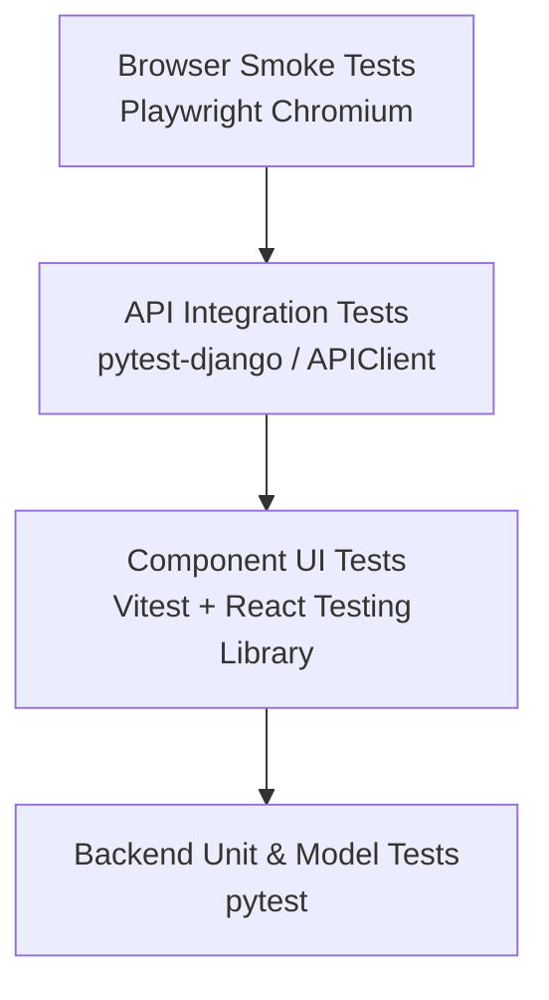

# LogiFlows Test Strategy & QA Specification

## 1. Quality Assurance Philosophy
LogiFlows enforces a multi-tiered test strategy across unit, component, API integration, and browser smoke test levels.
Testing is an automated regression gate: no code is marked complete without executable test coverage.

---

## 2. Test Pyramid & Execution Levels

### 2.1 Backend Tests (`backend/tests/` & `pytest`)
- **Framework**: `pytest`, `pytest-django`, Django Test framework.
- **Scope**:
  - `test_health.py`: Health endpoint (`/api/v1/health/`), readiness probe (`/api/v1/readiness/`), failure simulation, 404 envelope.
  - `test_docs.py`: OpenAPI schema generation (`/api/v1/schema/`), Swagger UI (`/api/v1/docs/`), ReDoc (`/api/v1/redoc/`).
  - `test_database.py`: PostgreSQL connectivity, custom `User(AbstractUser)` model instantiation, system check verification.

### 2.2 Frontend Unit & Component Tests (`frontend/src/tests/` & `vitest`)
- **Framework**: `vitest`, `@testing-library/react`, `@testing-library/jest-dom`.
- **Scope**:
  - `components.test.tsx`: Button variants, Badge colors/dots, Card hierarchy, Input states, Logo branding, Breadcrumbs.
  - `navigation.test.tsx`: Route resolution for Landing Page (`/`), Status Page (`/app/status`), Architecture (`/app/architecture`), and 404 (`*`).
  - `api.test.ts`: Centralized Axios client, interceptor behavior, health, readiness, and platform-info API functions.
  - `App.test.tsx`: Full application root integration with TanStack Query and React Router providers.

### 2.3 End-to-End Browser Smoke Tests (`frontend/e2e/` & `playwright`)
- **Framework**: Playwright with Chromium headless engine.
- **Scope**:
  - `smoke.spec.ts`: Real browser navigation, page titles, interactive routing, dev console status cards, and 404 routing.
