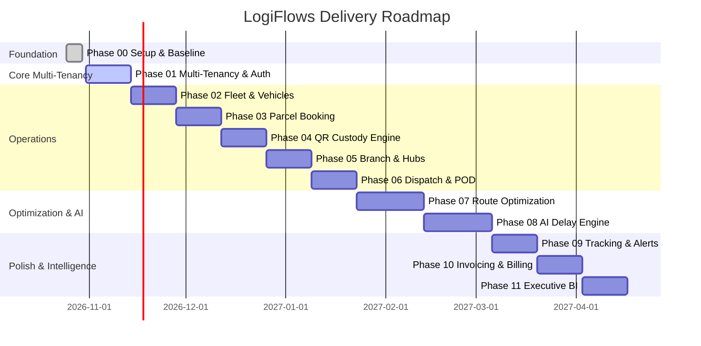

# LogiFlows 12-Phase Milestone Tracker

| Phase | Milestone | Deliverable Summary | Acceptance Status |
| :---: | :--- | :--- | :---: |
| **00** | **Project Setup & Docker Baseline** | Full-stack scaffolding, PostgreSQL 16, Django 5.1, React 18, 37 passing tests | **COMPLETE** |
| **01** | **Multi-Tenant Architecture & Auth** | Organization CRUD, JWT authentication, RBAC, tenant context middleware | **READY** |
| **02** | **Fleet & Vehicle Master** | Vehicle registry, driver assignments, vehicle telematics hooks | **BACKLOG** |
| **03** | **Parcel Booking & Waybill** | Consignment booking, volumetric rating, printable barcode waybills | **BACKLOG** |
| **04** | **QR Custody Engine** | Scan validations, handoff chain-of-custody audit log | **BACKLOG** |
| **05** | **Branch & Hub Staging** | Hub transfer manifests, staging bin allocation, cross-docking | **BACKLOG** |
| **06** | **Delivery & Dispatch** | Run-sheets, driver dispatch, electronic proof-of-delivery (POD) | **BACKLOG** |
| **07** | **Route Optimization** | Multi-stop TSP routing with traffic and road constraints | **BACKLOG** |
| **08** | **AI Delay Engine** | Machine learning delay probability models and alerts | **BACKLOG** |
| **09** | **Real-Time Tracking** | WebSockets live milestone events, customer SMS/email notifications | **BACKLOG** |
| **10** | **Invoicing & Billing** | Tariff rules, invoice generation, tax calculations, payment tracking | **BACKLOG** |
| **11** | **Executive Intelligence** | SLA breach reports, fleet utilization, carbon emission dashboards | **BACKLOG** |
