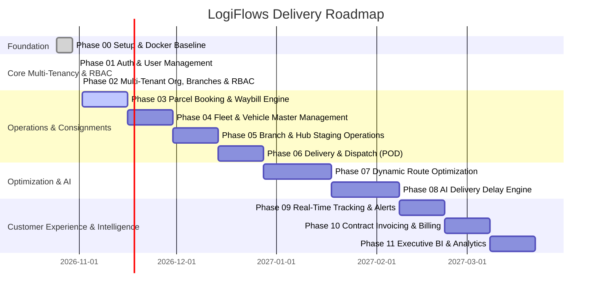

# LogiFlows 12-Phase Delivery Roadmap & Milestone Tracker

## Milestone Acceptance Status Table

| Phase | Milestone | Deliverable Summary | Acceptance Status |
| :---: | :--- | :--- | :---: |
| **00** | **Project Setup & Docker Baseline** | Full-stack scaffolding, PostgreSQL 16, Django 5.1, React 18, 37 passing baseline tests | **COMPLETE (APPROVED)** |
| **01** | **Authentication & User Management** | Custom User model, JWT in httpOnly cookie, single-use SHA-256 tokens, audit logging, RBAC baseline | **COMPLETE (APPROVED)** |
| **02** | **Multi-Tenant Architecture, Branch Hierarchy & RBAC** | Organization registration & verification queue, tenant isolation middleware, branch hierarchy with hubs and service areas, employee provisioning & role hierarchy, role-scoped dashboards | **COMPLETE (VERIFIED)** |
| **03** | **Parcel Booking & Waybill Engine** | Consignment booking, volumetric rating calculation, waybill and barcode generation, sender/recipient address validation | **READY (NEXT SPRINT)** |
| **04** | **Fleet & Vehicle Master Management** | Vehicle registry, capacity dimensions, driver assignments, vehicle telematics hooks (logged per `INCLUDE_FLEET=false`) | **BACKLOG** |
| **05** | **Branch & Hub Logistics Operations** | Hub inbound/outbound staging, bin allocations, transfer manifest management, cross-docking | **BACKLOG** |
| **06** | **Delivery & Dispatch** | Run-sheets, driver dispatch, electronic proof-of-delivery (POD) workflows | **BACKLOG** |
| **07** | **Dynamic Route Optimization** | Multi-stop TSP routing with road speed, traffic, and vehicle capacity constraints | **BACKLOG** |
| **08** | **AI Delivery Delay Engine** | Machine learning delay probability models, weather/traffic risk features, exception alerting | **BACKLOG** |
| **09** | **Real-Time Tracking & Notifications** | WebSockets live milestone events, customer SMS/email notifications, webhook dispatch | **BACKLOG** |
| **10** | **Contract Invoicing & Billing** | Contract tariff rules, invoice PDF generation, tax calculations, payment tracking | **BACKLOG** |
| **11** | **Executive Intelligence & BI** | SLA breach reports, fleet utilization, carbon emission dashboards, executive reporting | **BACKLOG** |
